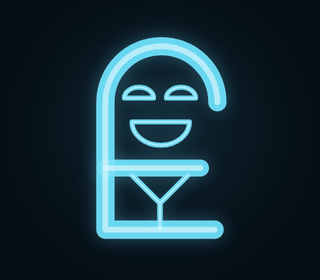

<div align="center">

# Open Eddy



**Call Eddy from *Lab Rats*. He answers — sarcastic, dramatic, slightly jealous, and somehow still helpful.**

[**Try it on the web →**](https://eddy.alexandrelanda.com) · [Website](https://openeddy.alexandrelanda.com) · [Run it on Linux](#linux-desktop-app)

[](https://ko-fi.com/alexandrelanda)


</div>

---

## What it is

Open Eddy is a voice AI shaped like a phone call. You sign in, tell Eddy your name, age and gender, and call him. He picks you up with a sarcastic greeting, listens while you talk, and answers out loud — sighing, scoffing and laughing at you — while a hologram of his face (drawn in code, 14 expressions) reacts to every line.

- **Hands-free call** — he listens, thinks, speaks, listens again. Mute, keyboard and hang up like a real phone.
- **Real voice acting** — ElevenLabs `eleven_v4_turbo` streaming, with audio tags (`[sighs]`, `[laughs]`, `[sarcastic]`…) that are *performed*, not read.
- **Real-time ears** — ElevenLabs Scribe v2 Realtime: your words appear live, and your turn closes ~0.5 s after you stop.
- **Knows who he's mocking** — your profile picks his nicknames (“kid”, “champ”, “missy”, “gramps”… in PT: “garoto”, “tiozão”…). Never “sir”.
- **Faces that stay** — the expression is driven by the same tags as the voice and holds between lines.
- **Languages** — Portuguese (default in the app), English, Spanish.

### Scenes (he takes over the call)

| Scene | Trigger | What happens |
|---|---|---|
| **Slams the phone** | you say goodbye | arrogant goodbye → angry hang-up → **calls you back** to insult you (cartoon insults only) → hangs up again |
| **"Bad signal"** | you insult him | “you're… break… ing up…” → glitch + static → call drops → he calls back: “I don't have bad signal, I *am* the signal” |
| **Silent treatment** | you mention another AI | jealous meltdown → “Eddy isn't talking to you” for a few seconds → dramatic forgiveness |
| **Ego explosion** | you praise him | fanfare + ● REC “recording this for posterity” |
| **On hold** | sometimes, before answering | hold music while the answer is generated |
| **Surprise call** | you idle on the home screen | Eddy calls *you*; decline and he calls back offended |

Lines are generated from the conversation with a stage direction (`core/scenes.py`), with fixed lines as fallback.

## Two ways to run it

| | Web ([eddy.alexandrelanda.com](https://eddy.alexandrelanda.com)) | Linux desktop |
|---|---|---|
| Brain | Puter AI, in your browser (your Puter account) | Gemma 4 E2B on Ollama, **local** |
| Ears | Browser mic → ElevenLabs Scribe (single-use token) | ElevenLabs Scribe, or faster-whisper offline |
| Voice | ElevenLabs via the server (daily limit per user) | ElevenLabs, or Kokoro offline |
| Account | Puter (profile in `puter.kv`) | Puter (profile in `puter.kv`) |

## Linux desktop app

Requirements: Rust, Node 20+, Python 3.11+, `libwebkit2gtk-4.1-dev`, `ffmpeg`, PipeWire/PulseAudio, and [Ollama](https://ollama.com).

```bash
git clone https://github.com/CreadorLanda/OpenEddy.git && cd OpenEddy
python3 -m venv .venv && .venv/bin/pip install -r requirements.txt
ollama pull gemma4:e2b-it-qat            # ~4.3 GB, fits a 16 GB laptop
# optional offline voice: put kokoro-v1.0.onnx + voices-v1.0.bin in ./kokoro/

# optional: ElevenLabs key in the system keyring (never on disk or in git)
secret-tool store --label="Open Eddy — ElevenLabs" service open-eddy account elevenlabs

cd app && npm install && npm run tauri dev
```

Without an ElevenLabs key the app runs fully offline (Whisper + Kokoro). `npm run tauri build` produces `.deb` / AppImage packages.

| Variable | Default | |
|---|---|---|
| `EDDY_MODEL` | `gemma4:e2b-it-qat` | Ollama model |
| `EDDY_ELEVEN_MODEL` | `eleven_v4_turbo` | ElevenLabs voice model (flash is cheaper but reads the tags aloud) |
| `EDDY_STT_SILENCE` | `0.7` | seconds of silence that close your turn |
| `EDDY_WHISPER` | `small` | offline speech-to-text model |

## Self-hosting the web version

`core/webapp.py` is a stdlib-only server (no numpy, no models): it serves `app/dist`, the landing page, and the ElevenLabs proxy. Every `/api` call needs the visitor's Puter token (checked against `api.puter.com/whoami`); voice and mic have daily limits.

```bash
cd app && npm install && npm run build && cd ..
ELEVENLABS_API_KEY=... EDDY_WEB_HOST=0.0.0.0 EDDY_WEB_PORT=8120 python3 core/webapp.py
```

| Variable | Default | |
|---|---|---|
| `EDDY_WEB_MODEL` | `gemini-3.5-flash-lite` | Puter AI model (falls back to Puter's default) |
| `EDDY_LANDING_HOSTS` | `openeddy.alexandrelanda.com` | hosts that get the landing page at `/` |
| `EDDY_TTS_CHARS_PER_USER` / `EDDY_TTS_CHARS_TOTAL` | `8000` / `60000` | daily voice budget (after that, the browser's own voice takes over) |
| `EDDY_UNLIMITED_USERS` | — | Puter usernames with no limit (e.g. the server owner) |
| `EDDY_STT_PER_USER` | `150` | daily mic sessions per user |

Put it behind HTTPS (the browser only gives the microphone to secure pages). `deploy/` has the systemd unit and Caddy block used for alexandrelanda.com.

## How it's built

```
app/   Tauri 2 + TypeScript — login, profile, call screen, hologram (src/eddy), landing (src/landing)
core/  Python — assistant.py (persona, nicknames, lines per language), voice.py (desktop mic/STT/TTS),
       eleven.py (ElevenLabs, stdlib), llm.py (Ollama), server.py (desktop core), webapp.py (web server)
```

## Support

If Eddy made you laugh (or feel judged), keep his ego — and the voice bill — alive: **[ko-fi.com/alexandrelanda](https://ko-fi.com/alexandrelanda)** ☕

## License & disclaimer

Code under the [MIT License](LICENSE). Open Eddy is an unofficial fan project; Eddy and *Lab Rats* belong to Disney, and this project is not affiliated with or endorsed by Disney.

## Star history

If Eddy made you smile, a ⭐ makes his ego even bigger.

[](https://star-history.com/#CreadorLanda/OpenEddy&Date)

---

<div align="center">

Made with ☕ by **[Alexandre Landa](https://github.com/CreadorLanda)** · [Ko-fi](https://ko-fi.com/alexandrelanda) · [GitHub](https://github.com/CreadorLanda/OpenEddy)

</div>
